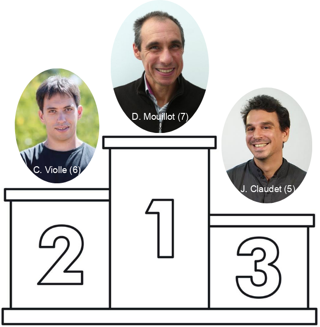
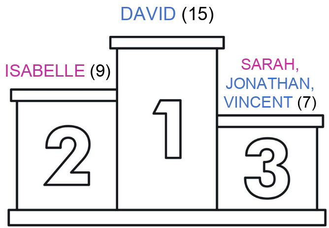

## How much do you know about CESAB?

<br> <br>

:::{.r-stack style="font-size: 1.5em;"}
When was CESAB created?
:::

<br>

:::{.r-stack .fragment style="font-size: 1.8em;"}
2010
:::

<br> <br>

:::{.r-stack .fragment style="font-size: 1.5em;"}
How many projects were supported and hosted at CESAB?
:::

<br>

:::{.r-stack .fragment style="font-size: 1.8em;"}
73
:::

<br> <br>

:::{.r-stack .fragment style="font-size: 1.5em;"}
How many researchers were hosted at CESAB?
:::

<br>

:::{.r-stack .fragment style="font-size: 1.8em;"}
885
:::


## How much do you know about CESAB?

<br>
<br>

:::{.r-stack style="font-size: 1.5em;"}
Who participated in most CESAB projects?
:::


:::{.r-stack .fragment}

:::


## How much do you know about CESAB?

<br>
<br>

:::{.r-stack style="font-size: 1.5em;"}
What are the most popular first names among members?
:::

<br>

:::{.r-stack .fragment}

:::

```{r}
#| eval: false
#| echo: false

# Load cesab member list
cesab <- read.csv(
  here::here("data", "derived-data", "cesab_members.csv")
)
# remove guest and stagiaire
cesab <- cesab[!cesab$function_in_group %in% c("Guest", "Stagiaire"), ]
# remove non active members (and keep NA)
cesab <- cesab[!cesab$still_member %in% 0, ]

# answer quiz
# length(unique(cesab$group)) # 73
# sum(!duplicated(cesab$name)) # 885
# sort(table(cesab$name), decreasing = TRUE)[1:3]
# # Mouillot David, Violle Cyrille, Claudet Joachim
# sort(table(cesab$firstname[!duplicated(cesab$name)]), decreasing = TRUE)[1:3]
# # David, Isabelle Jonathan
```
