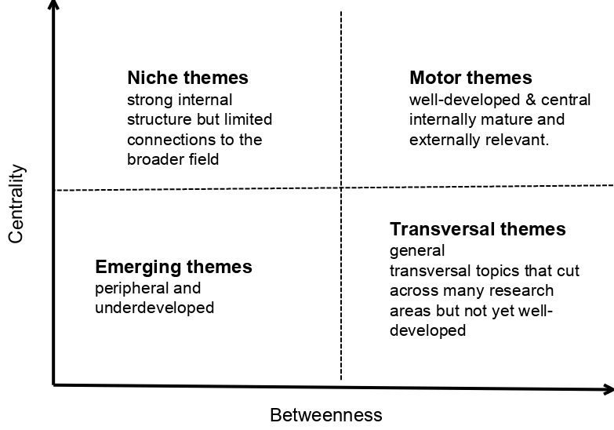

## Objectives

:::: {.columns}

::: {.column .logo width="10%"}

::: 
::: {.column .logo width="80%"}

<br> <br> <br> 

:::{style="font-size: 1.5em;"}
- Better understand the diversity of past and present CESAB projects
- Play around with network analysis
:::

<br> <br>

:::{.fragment style="font-size: 1.5em;"}
**Steps:**  

1. Network of group members
2. Network of group publications
3. Synthesis
:::

:::

::: {.column .logo width="10%"}

::: 

::::


## Bipartite member network

```{r}
#| label: setup
devtools::load_all()
library(igraph)
library(visNetwork)
library(plotly)

out_data <- here::here("data", "derived-data")

# load reference list
cesab <- read.csv(file.path(out_data, "cesab_members.csv"))

# remove guest and stagiaire
cesab <- cesab[!cesab$function_in_group %in% c("Guest", "Stagiaire"), ]

# remove non active members (and keep NA)
cesab <- cesab[!cesab$still_member %in% 0, ]

# merge the Free groups
cesab$group <- gsub("Free 2", "Free", cesab$group)

# remove duplicates (mostly for Pelagic 1 and 2)
cesab <- cesab[!duplicated(cesab[, c("group", "name")]), ]

# get the list of projects per member
infoV <- tapply(cesab$group, cesab$name, paste, collapse = "<br>")

# number of members per project
nmem <- table(cesab$group)

# number of projects per member
nproj <- table(table(cesab$name))

# set color based on year
yrpro <- tapply(cesab$start_year, cesab$group, min)
yrseq <- min(yrpro):max(yrpro)
palyr <- rev(hcl.colors(
  n = length(yrseq) + 4,
  palette = "greens"
)[1:length(yrseq)])
names(palyr) <- yrseq

colpro <- palyr[as.factor(yrpro)]
names(colpro) <- names(yrpro)

# set color based on gender
umem <- sort(unique(cesab$name))
palgn <- c("M" = "#4472c4", "F" = "#c4339d")
colgn <- palgn[cesab$gender[match(umem, cesab$name)]]
names(colgn) <- umem

# citation dataset
M <- readRDS(file.path(out_data, "cesab_bibliometrix.rds"))

M$shorttitle <- substr(firstup(M$display_name), 1, 30)
M$breaktitle <- breaks_string(firstup(M$display_name))
# M$linkDOI <- paste0(
#   "<a href=\'",
#   paste0("https://www.doi.org/", M$DI),
#   "\'>",
#   M$DI,
#   "</a>"
# )

# remove _Core publications
M$project <- gsub("_Core", "", M$project)
M$project <- gsub("^, ", "", M$project)
M <- M[M$project != "", ]
```


::::{ .columns }

:::{ .column width="75%"}

```{r}
netBI <- graph_from_data_frame(
  cesab[, c("name", "group")]
)
V(netBI)$type <- V(netBI)$name %in% cesab$group

V(netBI)$color <- ifelse(
  V(netBI)$type,
  colpro[V(netBI)$name],
  colgn[V(netBI)$name]
)
V(netBI)$shape <- ifelse(V(netBI)$type, "square", "dot")
# V(netBI)$size <- ifelse(V(netBI)$type, 3, 1)
V(netBI)$group <- ifelse(V(netBI)$type, V(netBI)$name, "Members")

extra <- ifelse(
  V(netBI)$type,
  yrpro[V(netBI)$name],
  infoV[match(V(netBI)$name, names(infoV))]
)
V(netBI)$title <- paste(
  V(netBI)$name,
  extra,
  sep = "<br>"
)

# remove members that are not connected to multiple groups
# for visualization purpose only
showBI <- delete_vertices(netBI, degree(netBI) == 1)

visNetwork::visIgraph(
  showBI,
  randomSeed = 25,
  layout = "layout_with_fr",
  smooth = TRUE
) |>
  visInteraction(
    hover = TRUE,
    selectable = TRUE
  ) |>
  visOptions(
    highlightNearest = list(
      enabled = TRUE
    ),
    selectedBy = list(variable = "group", multiple = T)
  )
```

:::
:::{ .column width="25%"}

<br>
<br>
<br>


```{r}
par(mar = c(0, 0, 0, 0))
plot.new()
legend(
  "center",
  legend = c(
    "Male",
    "Female",
    "",
    "2010",
    "2018",
    "2026"
  ),
  col = c(palgn, NA, palyr[c("2010", "2018", "2026")]),
  pch = c(19, 19, NA, 15, 15, 15),
  cex = 3,
  bty = "n",
  ncol = 2,
  title = "Members           Project",
  xpd = NA
)
```

:::
::::


## Centrality


```{r}
# Zachary
g <- make_graph("Krackhardt kite")
dg <- degree(g)
pr <- page_rank(g)$vector
bt <- betweenness(g)
V(g)$title <- paste(
  paste0("PR centrality: ", round(pr, 3)),
  paste0("betweenness: ", round(bt, 1)),
  paste0("degree: ", dg),
  sep = "<br>"
)

# ei <- eigen_centrality(g)$vector
# mat <- as_adjacency_matrix(g)
# pca <- prcomp(mat, center = FALSE, scale = FALSE)
# cor(as.numeric(pca$rotation[, 1]), ei)
```

::::{ .columns }

:::{ .column width="45%"}

#### PageRank centrality

Measure the node's importance in a network: how it is linked to highly connected nodes.

```{r}
V(g)$color <- pals::viridis(10)[cut(
  pr,
  seq(0, max(pr), length.out = 11),
  include.lowest = TRUE
)]
visNetwork::visIgraph(g, randomSeed = 25, layout = "layout_with_fr") |>
  visInteraction(
    hover = TRUE,
    selectable = TRUE
  ) |>
  visOptions(
    highlightNearest = list(
      enabled = TRUE
    )
  )
```

:::

:::{ .column width="10%"}
<!--blank-->
:::

:::{ .column width="45%" .fragment}

#### Betweenness

Identify bridges, quantified by the number of shortest path passing through a node.

```{r}
V(g)$color <- pals::viridis(10)[cut(
  sqrt(bt),
  seq(0, max(sqrt(bt)), length.out = 11),
  include.lowest = TRUE
)]
visNetwork::visIgraph(g, randomSeed = 25, layout = "layout_with_fr") |>
  visInteraction(
    hover = TRUE,
    selectable = TRUE
  ) |>
  visOptions(
    highlightNearest = list(
      enabled = TRUE
    )
  )
```

:::

::::

## Centrality plot


::: {.column .logo width="20%"}

::: 
::: {.column .logo width="60%"}

<br> <br> <br>



:::

::: {.column .logo width="20%"}

::: 

## Collaboration centrality

```{r}
#| echo: false
splitBI <- bipartite_projection(netBI)
netMEM <- splitBI$proj1
netPR <- splitBI$proj2
```

::::{ .columns }

:::{ .column width="45%"}

#### Project centrality

```{r}
centP <- data.frame(
  "degree" = degree(netPR),
  # "centrality" = eigen_centrality(netPR)$vector,
  "centrality" = page_rank(netPR)$vector,
  "betweenness" = betweenness(netPR),
  "lab" = V(netPR)$title,
  "color" = colpro[V(netPR)$name]
)

plot_ly(centP, width = 800, height = 800) |>
  add_markers(
    x = ~betweenness,
    y = ~centrality,
    size = ~degree,
    marker = list(color = ~color, line = list(color = ~color)),
    text = ~lab,
    hoverinfo = "text"
  ) |>
  config(
    modeBarButtons = list(list("toImage")),
    displaylogo = FALSE
  )
```


:::

:::{ .column width="45%" .fragment}

#### Member centrality

```{r}
# Centrality
centR <- data.frame(
  "betweenness" = betweenness(netMEM),
  "degree" = degree(netMEM),
  # "centrality" = eigen_centrality(netMEM)$vector,
  "centrality" = page_rank(netMEM)$vector,
  "lab" = V(netMEM)$title,
  "color" = colgn[V(netMEM)$name]
)


plot_ly(centR, width = 800, height = 800) |>
  add_markers(
    x = ~betweenness,
    y = ~centrality,
    size = ~degree,
    marker = list(color = ~color, line = list(color = ~color)),
    text = ~lab,
    hoverinfo = "text"
  ) |>
  config(
    modeBarButtons = list(list("toImage")),
    displaylogo = FALSE
  )
```

:::

::::

## Publications network

```{r}
# get the co-citation network of references
NetMatrix <- bibliometrix::biblioNetwork(
  M,
  analysis = "coupling",
  network = "references",
  n = NULL,
  short = FALSE,
  sep = ";"
)
# dim(NetMatrix) # 406

netCC <- igraph::graph_from_adjacency_matrix(
  NetMatrix,
  mode = "undirected",
  diag = FALSE,
  weighted = TRUE
)
m0 <- match(V(netCC)$name, M$SR)
V(netCC)$name <- M$shortname[m0]
V(netCC)$label <- NA
V(netCC)$title <- paste(
  V(netCC)$name,
  M$shortjournal[m0],
  M$breaktitle[m0],
  M$DI[m0],
  M$project[m0],
  sep = "<br>"
)

# Centrality
centC <- data.frame(
  "betweenness" = betweenness(netCC),
  "degree" = degree(netCC),
  "centrality" = page_rank(netCC)$vector,
  "lab" = V(netCC)$title,
  "year" = sapply(strsplit(V(netCC)$name, "_"), function(x) x[[2]])
)

V(netCC)$color <- palyr[centC$year]
# pals::viridis(5)[cut(centC$centrality, seq(0, 1, 0.2))]
E(netCC)$color <- grDevices::adjustcolor("gray", alpha.f = 0.8)
E(netCC)$width <- 0.3
V(netCC)$size <- 10
```


::::{ .columns }

:::{ .column width="45%"}
#### Bibliographic coupling 
```{r}
showCC <- delete_vertices(netCC, degree(netCC) == 0)
V(showCC)$reference <- V(showCC)$name
# check out other layout
visNetwork::visIgraph(
  showCC,
  layout = "layout_with_fr",
  idToLabel = FALSE,
  randomSeed = 25,
  type = "full"
) |>
  visOptions(
    highlightNearest = TRUE,
    selectedBy = list(variable = "reference")
  )
```

:::

:::{ .column width="45%" .fragment}
#### Reference centrality
```{r}
centC$color <- palyr[centC$year]

plot_ly(centC, height = 800, width = 800) |>
  add_markers(
    x = ~betweenness,
    y = ~centrality,
    size = ~degree,
    marker = list(color = ~color, line = list(color = ~color)),
    text = ~lab,
    hoverinfo = "text"
  ) |>
  config(
    modeBarButtons = list(list("toImage")),
    displaylogo = FALSE
  )
```

:::
::::

## Synthesis

::::{ .columns }

:::{ .column width="25%"}

<br> <br> <br> 

- node = project  
*group with no publications were removed*  


- edge = number of shared members + average number of shared citations   
*edges with low values (<1) were discarded*

```{r}
# calculate relations among project
m1 <- as.matrix(as_adjacency_matrix(netCC, attr = "weight"))
pw <- c()
upro <- sort(unique(cesab$group))
for (i in 1:(length(upro) - 1)) {
  mi <- cesab$name[cesab$group == upro[i]]
  ri <- M$shortname[grepl(upro[i], M$project)]
  for (j in (i + 1):length(upro)) {
    mj <- cesab$name[cesab$group == upro[j]]
    rj <- M$shortname[grepl(upro[j], M$project)]
    # add paiwize link only if both projects have publications
    if (length(ri) > 0 & length(rj) > 0) {
      mij <- as.matrix(m1[dimnames(m1)[[1]] %in% ri, dimnames(m1)[[2]] %in% rj])
      nij <- graph_from_biadjacency_matrix(mij, weighted = TRUE)

      pwij <- data.frame(
        "p1" = upro[i],
        "p2" = upro[j],
        "N_ref" = sum(mij > 0), # number of edges
        "W_ref" = mean(mij), # sum(mij) / (nrow(mij) * ncol(mij))
        "C_ref" = sum(mij > 0) / (nrow(mij) * ncol(mij)),
        "N_mem" = sum(mi %in% mj),
        "J_mem" = sum(mi %in% mj) / length(unique(c(mi, mj)))
      )
      pw <- rbind(pw, pwij)
    }
  }
}

# pairs(
#   pw[, -(1:2)],
#   lower.panel = panel.smooth,
#   upper.panel = panel.cor,
# )

# W_ref and J_mem are most correlated
pw$sW_ref <- sqrt(pw$W_ref)
pw$sN_mem <- sqrt(pw$N_mem)
# boxplot(pw[, c("sW_ref", "sN_mem")])

# Create the network
pw$weight <- pw$sW_ref + pw$N_mem
# boxplot(pw$weight)
# remove pairwize list with low value
pw1 <- pw[pw$weight > 1, ]

netP <- igraph::graph_from_data_frame(
  d = pw1,
  directed = FALSE
)

# add missing project : 29 too many!
# miss <- upro[!upro %in% V(netP)$name]
# netP <- add_vertices(netP, length(miss), name = miss)

modP <- cluster_leiden(
  netP,
  objective_function = "modularity",
  weights = E(netP)$weight
) |>
  membership()

# modularity(netP, modP, weights = E(netP)$weight)
# 0.47 : good

# handle isolated groups
# np <- table(modP)
# convmod <- data.frame(
#   "ori" = c(names(np)[np > 1], names(np)[np == 1]),
#   "new" = c(rank(names(np)[np > 1]), rep(sum(np > 1) + 1, sum(np == 1)))
# )
# modP <- convmod$new[match(modP, convmod$ori)]
```

:::

:::{ .column width="75%"}

```{r}
V(netP)$year <- yrpro[V(netP)$name]
V(netP)$group <- modP # ifelse(modP == max(modP), "isolated", modP)
pal <- RColorBrewer::brewer.pal(max(modP), "Set2") # c(RColorBrewer::brewer.pal(max(modP) - 1, "Set2"), "#b5b5b5")
V(netP)$color <- pal[modP]
E(netP)$width <- E(netP)$weight
V(netP)$title <- paste(
  V(netP)$name,
  V(netP)$year,
  sep = "<br>"
)

E(netP)$color <- apply(igraph::as_edgelist(netP), 1, function(x) {
  return(ifelse(modP[x[1]] != modP[x[2]], "#606060", pal[modP[x[1]]]))
})

visNetwork::visIgraph(
  netP,
  randomSeed = 73,
  layout = "layout_with_fr",
  weights = E(netP)$weight
) |>
  visOptions(
    highlightNearest = TRUE,
    selectedBy = list(variable = "group", multiple = T)
  ) |>
  visPhysics(stabilization = FALSE)
```

:::
::::


## Synthesis

::::{ .columns }

:::{ .column width="60%"}
#### Temporal network
```{r}
# x-axis by year
vyr <- V(netP)$year
xnod <- (vyr - min(vyr)) / (max(vyr) - min(vyr)) * 2 - 1

# take the membership as y-axis
ymod <- as.numeric(as.factor(modP))
ynod <- ((ymod / max(ymod)) * 2 - 1) * 2
# coordinates
coo <- cbind(jitter(xnod, 1.5), jitter(ynod, 1.5))


visNetwork::visIgraph(
  netP,
  layout = 'layout.norm',
  layoutMatrix = coo,
  type = "full"
) |>
  visOptions(
    highlightNearest = TRUE
  )
```

:::

:::{ .column width="40%" .fragment}
#### Keywords

```{r}
# ID, ID_raw (=ID with percentage), KW longer list
prosplit <- sapply(M$project, strsplit, ", ")
df <- data.frame(
  "project" = unlist(prosplit),
  "keywords" = rep(M$ID, sapply(prosplit, length)),
  "title" = rep(M$TI, sapply(prosplit, length))
)
df$module <- modP[match(df$project, names(modP))]
# remove NAs # sort(unique(df$project[is.na(df$module)]))
df <- df[!is.na(df$module), ]

keysplit <- sapply(df$keywords, strsplit, "; ")
ukey <- sort(unique(unlist(keysplit))) # 525 unique keywords or 817
# simplify the list of keywords
# rm <- c()
# for (i in seq_along(ukey)) {
#   rmi <- grep(ukey[i], ukey)
#   rm <- c(rm, rmi[rmi != i])
# }
# ukey <- ukey[-sort(unique(rm))]

# refkey <- sapply(ukey, function(x) {
#   as.numeric(grepl(x, df$keywords))
# }) # 320 publications, 556 keywords
# reftit <- sapply(ukey, function(x) {
#   as.numeric(grepl(x, df$title))
# })
# # chisq.test(table(as.vector(reftit), as.vector(refkey)))
# # either in keywords or title
# refall <- refkey + reftit

refall <- t(sapply(keysplit, function(x) {
  as.numeric(ukey %in% x)
})) # 1151 keywords, 1123 publications

refall[refall > 1] <- 1
dimnames(refall)[[2]] <- tolower(ukey)
# remove unfrequent keywords
refall <- refall[, colSums(refall) >= 3]

# standardize the number of keywords per publication
# stkey <- t(t(refall) / rowSums(refall))
# stkey[is.na(stkey)] <- 0

keymod <- rowsum(refall, df$module)

# percentage of publication with the keywords
permod <- keymod / as.numeric(table(df$module))

# percentage of keywords
perkey <- t(t(keymod) / colSums(keymod))
```


```{r}
#| fig.width: 6
#| fig.height: 8
#| fig.res: 200
#| 
th_group <- 0.2
par(mfrow = c(4, 2), mar = c(0, 0, 0, 0), xpd = NA, oma = c(0, 0, 0, 0))
for (i in 1:max(modP)) {
  ti <- permod[i, ] > 0
  ni <- max(sum(permod[i, ] >= th_group & perkey[i, ] >= 1 / max(modP)), 10)
  wi <- sort(rank(permod[i, ti]) + rank(perkey[i, ti]), decreasing = TRUE)[1:ni]
  # wi <- sort(permod[i, ti] + perkey[i, ti], decreasing = TRUE)[1:ni]

  neti <- delete_vertices(netP, modP != i)
  ceni <- page_rank(neti)$vector
  grplab <- paste(
    names(ceni)[order(ceni, decreasing = TRUE)[1:min(length(ceni), 5)]],
    collapse = ", "
  )
  labi <- paste0("Groupe ", i, ": ", grplab) |> breaks_string(each = 40)
  labi <- gsub("<br>", "\n", labi)
  wordcloud::wordcloud(
    names(wi),
    rank(wi),
    scale = c(2, .2),
    random.order = FALSE,
    colors = RColorBrewer::brewer.pal(8, "Dark2"),
    rot.per = 0
  )
  mtext(labi, side = 3, line = ifelse(grepl("\n", labi), -3, -2))
  # mtext(labi, side = ifelse(i < 3, 3, 1), line = ifelse(i < 3, 1, 2))
  rect(par()$usr[1], par()$usr[3], par()$usr[2], par()$usr[4], border = pal[i])
}
```

:::

::::

## Conclusion

:::{.r-stack}
to be continued ...
:::

<br> <br>

:::{.r-stack .fragment}
and thanks for the good time at CESAB :)
:::

## Extra: Project's centrality

```{r}
# Centrality
centS <- data.frame(
  "betweenness" = betweenness(netP),
  "degree" = degree(netP),
  "centrality" = page_rank(netP)$vector,
  "lab" = V(netP)$title,
  "color" = V(netP)$color
)


plot_ly(centS, width = 800, height = 800) |>
  add_markers(
    x = ~betweenness,
    y = ~centrality,
    size = ~degree,
    marker = list(color = ~color, line = list(color = ~color)),
    text = ~lab,
    hoverinfo = "text"
  ) |>
  config(
    modeBarButtons = list(list("toImage")),
    displaylogo = FALSE
  )
```
